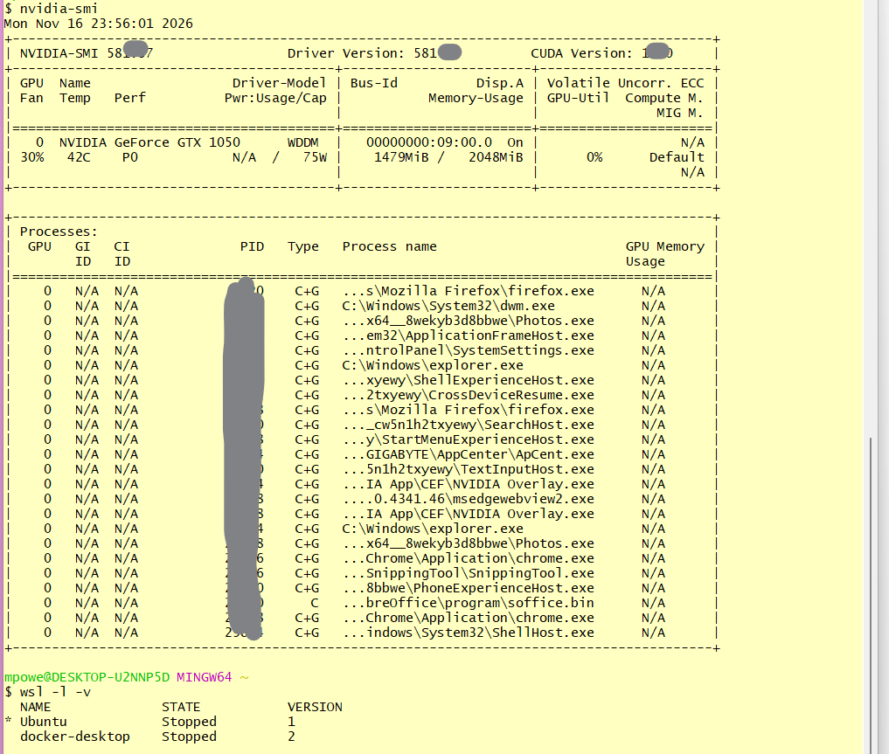

You can check both your Windows NVIDIA driver version and WSL2 GPU passthrough directly from Git Bash using nvidia-smi and wsl commands.
Note that I cannot check your local PC's current installed driver state because I do not have live access to your Windows machine, nor do I have a record of whether you completed that driver upgrade in another thread. Running the commands below will give you the exact current status on your system.

1. Check Your Windows NVIDIA Driver Version

Run this directly in Git Bash to verify the Windows host driver (WSL2 shares the Windows host driver; you should never install a separate Linux GPU driver inside WSL2):
bash
nvidia-smi
Use code with caution.
• What to look for: The top-right corner of the table shows Driver Version (e.g., 560.xx or newer) and CUDA Version (the maximum CUDA version your driver supports). If this command fails or shows an older version than you expect, the Windows driver upgrade either didn't complete or isn't in your system PATH.

2. Verify WSL2 is Installed and Running Version 2

Check that your Linux distribution is actually using WSL2 (WSL1 does not support GPU passthrough):
bash
wsl -l -v
Use code with caution.
• What to look for: Your distro (such as Ubuntu or docker-desktop) should list 2 under the VERSION column.

3. Test GPU Passthrough Inside WSL2

Run nvidia-smi inside your WSL2 environment from Git Bash (using MSYS_NO_PATHCONV=1 prevents Git Bash from mangling Linux file paths):
bash
MSYS_NO_PATHCONV=1 wsl nvidia-smi
Use code with caution.
• What to look for: If it prints the same GPU table inside WSL2, WSL2 GPU passthrough is active and working.
• You can also check for the WSL2 virtual GPU device node directly:bash
MSYS_NO_PATHCONV=1 wsl ls -la /dev/dxg
Use code with caution.
If /dev/dxg exists, Windows has successfully exposed DirectX/CUDA paravirtualization to WSL2.

4. Test GPU Access Inside Docker

To confirm Docker Desktop can pass that WSL2 GPU into an actual CUDA container:
bash
docker run --rm --gpus all nvidia/cuda:12.6.0-base-ubuntu24.04 nvidia-smi
Use code with caution.
• What to look for: Docker will pull a small base image (if not cached) and print the nvidia-smi output from inside the container. If you get an error like could not select device driver "" with capabilities: [[gpu]], Docker Desktop's WSL2 backend integration needs to be enabled in Docker Desktop > Settings > General > Use the WSL 2 based engine.
If you want to paste the output of nvidia-smi or any error messages you get from those commands, I can tell you right away if your driver is up to date for your CUDA/vector DB setup or help troubleshoot passthrough.
