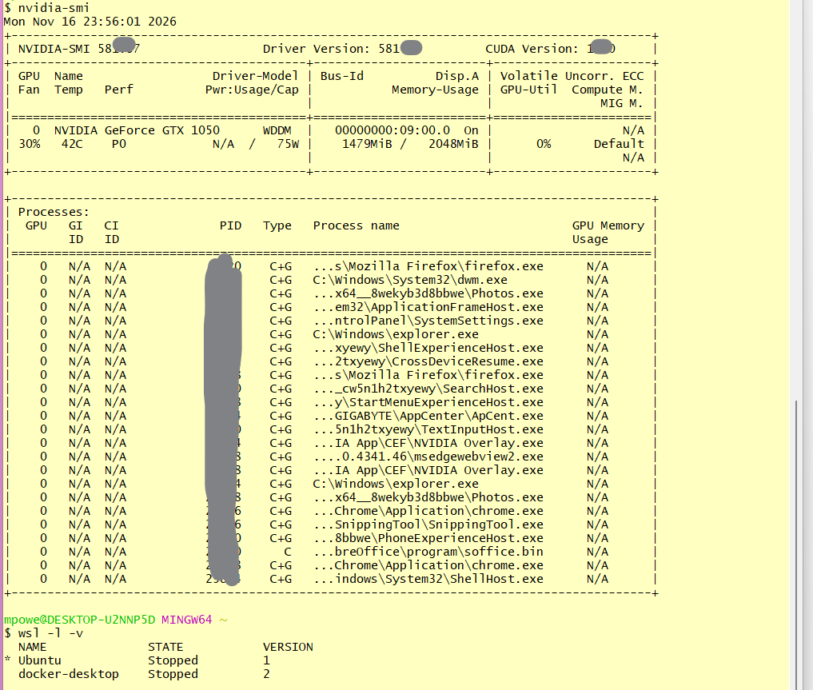

You can check both your Windows NVIDIA driver version and WSL2 GPU passthrough directly from Git Bash using nvidia-smi and wsl commands. Note that I cannot check your local PC's current installed driver state because I do not have live access to your Windows machine, nor do I have a record of whether you completed that driver upgrade in another thread. Running the commands below will give you the exact current status on your system.

Check Your Windows NVIDIA Driver Version.  You will also see what is running locally.



I ran the whisper code in transcribe and didn't see any activity on my gpu's.
So, with google AI (just a thread):


```python
python -c "import torch; print('CUDA Available:', torch.cuda.is_available()); print('Device:', torch.cuda.get_device_name(0) if torch.cuda.is_available() else 'CPU')"

pip uninstall torch torchvision torchaudio -y

pip install torch torchvision torchaudio --index-url https://download.pytorch.org/whl/cu128

pip install nvidia-cublas-cu12 nvidia-cudnn-cu12


```


How to Force 100% Offline Mode (Zero Network Requests)

If you want to guarantee that faster-whisper never even pings Hugging Face to check for model updates on future runs, add local_files_only=True to WhisperModel:
```python
self.shared_model = WhisperModel(
    self.model_size,
    device="cuda",
    compute_type="int8",
    local_files_only=True  # Forces strictly local execution; never touches the network
)```

Use code with caution.
(Now that "base" is already cached on your machine, local_files_only=True will load it straight from disk with zero HTTP requests. If you ever switch to "small" or "medium", run it once without local_files_only=True to cache the weights, then turn local_files_only=True back on.)